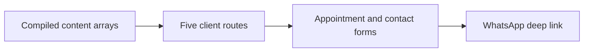

# Ávila GPS UI display standards

Observed on [https://calm-paprenjak-88c7de.netlify.app/](https://calm-paprenjak-88c7de.netlify.app/) on 13 November 2026. This document is the inventory of how that site shows information, which brand tokens every surface uses, and how visitor data enters and leaves the browser.

Use it when documenting a screen, restyling a view, or adding a form. Project rules in `.cursor/rules/` state what to do. The `avila-gps-ui` skill is the workflow. This file holds the detail.

## 1. What the interface is

Ávila GPS (Gestión Profesional de Salud) is a Spanish marketing site for a medical provider in Valera, Trujillo. It is a React single-page app (React Router, Tailwind, Framer Motion, Lucide icons) deployed as static files on Netlify.

Content is compiled into the JavaScript bundle. There is no database read on the page, no `localStorage`, and no `sessionStorage`. Visitor fields stay in React state until submit, then leave through a WhatsApp deep link.



### Routes

These paths work after the app has loaded from `/`:

| Path | Screen |
| --- | --- |
| `/` | Home |
| `/nosotros` | About, stats, allied clinics |
| `/servicios` | Service portfolio and partner groups |
| `/equipo-medico` | Doctor directory |
| `/contacto` | Contact form, hours, map, document lists |
| `*` | Client catch-all inside the running app |

A direct request such as `/servicios` returns Netlify’s “Page not found”. The host does not rewrite those paths to `index.html`, so the client router never starts.

### Shared chrome on every route

- Splash, about 2.2 seconds, then a 0.8 second fade.
- Fixed glass header with logo, five links, and “Solicitar Atención”.
- Mobile drawer below the `md` breakpoint.
- Footer in `#0A1F4D` with navigation and contact.
- Fixed green WhatsApp button, bottom right.
- Appointment modal, opened from header, cards, and “Agendar Cita”.

## 2. Brand tokens

### Color

| Role | Hex | Where it appears |
| --- | --- | --- |
| Ink and hero | `#0A2A6B` | Body text, hero background |
| Deep navy | `#0A1F4D` | Footer, splash, modal overlay at 70% |
| Link blue | `#033CA0` | Links, active chips, icon tint |
| Sky | `#5BB2F5` | Highlights, scrollbar thumb, icon accent |
| Action green | `#6CC24A` | Primary actions, selection, active carousel dot |
| Green deep | `#0F7A33` | End of the primary button gradient |
| Hover green | `#78D154` to `#128A3A` | Primary button hover |
| Page | `#F4F8FC` | Page background |
| Card | `#FFFFFF` | Cards, modal, inputs |
| Slate | Tailwind slate 500–700 | Secondary labels and empty hints |

Text selection is green on white: `selection:bg-[#6CC24A] selection:text-white`.

### Type

Body is Montserrat, loaded at weights 300, 400, 500, and 600, including italics. The page sets `font-['Montserrat',sans-serif]` at 16px with `antialiased`.

| Use | Classes |
| --- | --- |
| Field labels and chips | `text-xs font-medium` |
| Card body | `text-sm` or `text-xs sm:text-sm`, often `font-light` or `font-normal` |
| Section titles | `text-3xl sm:text-4xl lg:text-5xl`, `tracking-tight` |
| Hero | `text-4xl sm:text-6xl lg:text-7xl` with a light text shadow |
| Eyebrows | `text-xs tracking-wide` or `tracking-wider uppercase` |

Caveat is requested from Google Fonts and `.font-script` exists in the stylesheet. No component applies that class. Body text stays Montserrat.

### Shape

| Radius | Pixels | Use |
| --- | --- | --- |
| `rounded-full` | pill | Nav, buttons, filter chips, carousel dots, WhatsApp button, icon circles |
| `rounded-3xl` | 24 | Cards, modal panel, mobile drawer |
| `rounded-2xl` | 16 | Icon tiles, partner tiles, glass chips |
| `rounded-xl` | 12 | Text inputs, textareas, modality toggles |

### Surface

Glass header: `bg-white/55` to `bg-white/90`, backdrop blur, white border, soft blue shadow.

Cards: white or `bg-white/85`, border `border-slate-100` or `border-white`, shadow `shadow-sm` to `shadow-md`. Hover lifts the card (`y: -6`) and raises the shadow to `shadow-2xl`. Icon wells shift to green on hover (`group-hover:bg-[#6CC24A]`).

Primary button class `.btn-green-gradient`:

- Color white.
- Background `linear-gradient(135deg, #6CC24A 0%, #0F7A33 100%)`.
- Shadow `0 8px 20px -4px #6CC24A66`.
- Hover lightens the gradient, moves the button up 2px, and deepens the shadow.
- Transition 0.3s.

Inputs: full width, `px-4 py-2.5`, `rounded-xl`, `border-slate-200`, `text-xs text-[#0A2A6B]`. Focus ring is `focus:ring-2 focus:ring-[#6CC24A]`.

Scrollbar: track `#EBF4FC`, thumb `#5BB2F5`, thumb hover `#033CA0`, 8px, fully rounded.

### Motion

| Moment | Behavior |
| --- | --- |
| Splash | Holds 2200 ms, then fades out over 0.8 s with ease `[0.76, 0, 0.24, 1]` |
| Splash mark | ECG stroke, `animate-ecg`, 2.5 s loop |
| Modal | Spring in from scale 0.92 and 20px down, duration 0.5, bounce 0.15 |
| Cards | Fade and rise, staggered about 0.06–0.08 s, hover lift 6px |
| WhatsApp button | Enters after 1 s; a ping ring sits behind it |
| Page change | Scroll to top, or to a hash target after 100 ms |
| Confetti | On a successful submit. Colors `#6CC24A`, `#0F7A33`, `#5BB2F5`, `#033CA0` |

### Layout widths

Content sits in `max-w-6xl` (services and home sections), `max-w-7xl` (closing band), or `max-w-3xl` (modal). Page padding is `px-4 sm:px-6`. Breakpoints in use are `sm`, `md`, and `lg`. The header nav is `hidden md:flex`. The mobile drawer is `md:hidden`.

## 3. How to read a display model

Each model below answers four questions:

1. **What** is on screen.
2. **Where** it appears.
3. **When** it is the right model.
4. **Why** that model was chosen for this data.

Directories, partners, services, and stats render as cards, chips, or a carousel. The live site does not use an HTML table, pagination, or column sort.

## 4. Display models

### 4.1 Splash

**What.** Full-screen `#0A1F4D`, the line “Cargando tu bienestar…”, and an ECG stroke.

**Where.** Fixed overlay, `z-50`, on first paint of the app.

**When.** Before the hero and its images are ready to show.

**Why.** The hero is a full-bleed photo plus a cut-out doctor. The splash covers the unfinished first frame. It also runs on later visits. It is a timer (2200 ms), not a check that images have loaded.

### 4.2 Glass header and mobile drawer

**What.** Logo (`logo.png`, 578×215), links Inicio, Nosotros, Servicios, Equipo Médico, Contacto, and a green pill “Solicitar Atención”. Below `md`, a round menu button opens a white drawer (`bg-white/95`, `rounded-3xl`, `max-w-sm`).

**Where.** `fixed top-3 sm:top-5`, inset on the x axis, `z-40`.

**When.** Every route.

**Why.** The header floats over the hero photo, so it uses glass instead of a solid bar. The active link uses `bg-[#033CA0]/10 text-[#033CA0]`. Idle links are `text-slate-600` and turn `#033CA0` on hover.

### 4.3 Hero

**What.** A full-viewport navy section (`min-h-[92vh] lg:min-h-screen`, `bg-[#0A2A6B]`) with `hero-bg-base.png`, the cut-out `doctor-transparent.png`, the headline “Atención médica integral, cuando la necesitas.”, a one-sentence lede, two pills, and four glass chips: Asistencia médica primaria, Telemedicina 24/7, Médicos en el hogar, Cirugías electivas.

**Where.** Top of `/` only. The hero chips say 24/7. Later home copy for telemedicine says 12 h/7. See section 7.

**When.** The first screen of the marketing home page.

**Why.** One promise, two actions (“Solicitar atención” and “Conoce más”), and four offerings as chips so the visitor can scan them without leaving the hero.

Primary pill uses `.btn-green-gradient`. The secondary pill is white text on a translucent blue (`bg-[#033CA0]/55`, white border, blur).

### 4.4 Unit cards and service grid

**What.** Three unit cards on the home page, then an eight-item icon grid.

Home units:

| Title | Summary |
| --- | --- |
| Unidad de Cardiología avanzada | Diagnóstico cardiovascular, electrocardiogramas, ecocardiogramas |
| Unidad de Radiología e imágenes | Radiología digital y ultrasonido |
| Medicina Ocupacional | Preempleo, control periódico, certificaciones, jornadas |

Home grid: Radiología e imágenes, Cardiología, Enfermería, Especialidades médicas, Protocolo COVID, Telemedicina, Toma de muestras en casa, Consultas en el hogar.

**Where.** `/`, sections “Unidades Médicas Especializadas” and “¿Qué ofrecemos?”.

**When.** A short catalog the visitor scans before opening a service.

**Why.** Each item is a title plus one sentence. A card with an icon is enough. The card is clickable and opens the appointment modal with that service selected.

Card anatomy: `bg-white/85` or `bg-white/90`, `backdrop-blur-md`, `rounded-3xl`, white border, `p-6` or `p-7`. Icon tile is `w-12 h-12` or `w-13 h-13`, `rounded-2xl`, `bg-slate-50`, `border-slate-100`.

### 4.5 Service rows

**What.** Ten long-form services. Each row has an image, title, paragraph, bullet list, and a request button.

| id | Title |
| --- | --- |
| `cardiology-unit` | Unidad de Cardiología avanzada |
| `radiology-imaging-unit` | Unidad de Radiología e imágenes |
| `occupational-medicine` | Medicina Ocupacional |
| `clinical-laboratory` | Laboratorio Clínico |
| `primary-medical-assistance` | Asistencia médica primaria |
| `covid-protocol` | Protocolo COVID |
| `telemedicine` | Telemedicina |
| `lab-home` | Toma de muestras en casa |
| `home-consultations` | Consultas en el hogar |
| `elective-surgeries` | Cirugías electivas |

**Where.** `/servicios`, under “Portafolio Médico Integral & Especializado”.

**When.** The visitor needs the scope of a service, not just its name.

**Why.** Bullets list what is included. The button label is “Solicitar {title}” and passes `modalServiceId` into the appointment modal. Rows alternate image side (`lg:flex-row-reverse`).

### 4.6 Proof row

**What.** Four facts: Profesionales / Altamente calificados, Atención rápida / Y personalizada, Tecnología / De vanguardia, Hogar y Sede / Atención integral.

**Where.** `/`, “¿Por qué elegirnos?”.

**When.** A trust strip with no numbers.

**Why.** These are claims, not counts. They stay as icon headings so they are not confused with the numeric stats on Nosotros.

### 4.7 Gradient band and closing card

**What.** A full-bleed band, `bg-gradient-to-r from-[#033CA0] via-[#0A2A6B] to-[#0F7A33]`, with the mission line and a green pill. A later card, `rounded-3xl`, repeats the human-care line and links to Nosotros.

**Where.** `/`, between the proof row and the partner carousel, and again near the footer.

**When.** A pause between catalogs, or a last call to act.

**Why.** The gradient is the only place navy and green share one surface. It marks a change of section without a new page.

### 4.8 Partner carousel

**What.** 28 records shaped `{name, sector}`. The home carousel shows four cards at a time, seven dots, and wraparound arrows. Filters are Todos, Aseguradoras, and Empresas.

**Where.** `/` (“Compañías Aseguradoras y Empresas”) and `/servicios` (the same records split into two static groups).

**When.** A logo-less name list that is too long for one row and too shallow for a directory page.

**Why.** Name plus sector is the whole record. A small card and a chip filter are enough. Aseguradoras keeps sectors that contain “Aseguradora”. Empresas is every other sector (banca, industria, educación, retail, and the rest).

Card: `bg-white p-4 rounded-2xl border border-slate-100 shadow-sm hover:shadow-md`. The active dot is `w-6 bg-[#6CC24A]`. Idle dots are `w-2 bg-slate-300`. The active filter chip is `bg-[#033CA0] text-white`.

The 28 names are Latitud Seguros, Seguros Miranda, Seguros Altamira, Seguros Venezuela, Mapfre, Banco de Venezuela (BDV), Banco Bicentenario del Pueblo, Seguros La Previsora, Seguros Constitución, Cuidamed, Grupo Nueve Once, Redyplan, Hispana de Seguros, Cemento Andino, El Poder de la Limpieza, Makroval, Valera Import, Super Max Hipermercado, Inversiones y Distribuciones Mi Ángel, U.E. Colegio Privado Cristóbal de Mendoza, Fi-ven, Palpitar Trujillano, Haz Médica, Grupo Odontológico Torres (GOT), Porcelanatos y Cerámicas Valera, Grupo Figue, Clínica Dental Cyty Dent Plus, and Won Motors S.A.

The home carousel has no empty message. A filter that matches nothing leaves a blank track.

### 4.9 Doctor directory

**What.** 48 records shaped `{id, name, specialty, category, photo}`. A search field matches name or specialty. Nine chips filter by category. Each card shows the photo, name, specialty, and “Agendar Cita”.

**Where.** `/equipo-medico`. Heading: “Especialistas en cada área de la salud”.

**When.** A filterable list of people, one action per person.

**Why.** Search plus chips answers “who” without a table. The photo is the identifier, the specialty is the second line, and the only action is booking.

| Category chip | Count |
| --- | --- |
| Medicina General | 5 |
| Pediatría | 7 |
| Cardiología | 3 |
| Traumatología | 1 |
| Ginecología | 6 |
| Cirugía | 3 |
| Medicina Interna | 2 |
| Otras Especialidades | 21 |
| Todas | 48 |

Search placeholder: “Buscar por nombre o especialidad médica...”. Matching is a case-insensitive substring on name or specialty, combined with the active category.

Empty state, when both filters exclude everyone:

- Title: “No se encontraron médicos”
- Hint: “Intenta cambiar los términos de búsqueda o el filtro de especialidad.”

“Agendar Cita” opens the appointment modal with that doctor’s name preselected.

Photos are remote stock images (Unsplash), not clinic portraits. The active chip is `bg-[#033CA0] text-white font-medium shadow-md`. Idle chips are `text-slate-600` on a slate pill track (`bg-slate-100 p-1 rounded-full`).

### 4.10 Stats and allied clinics

**What.** Four counters, then eleven allied institutions shaped `{name, city, tag}`.

| Value | Label | Description |
| --- | --- | --- |
| 15+ | Años de Experiencia | Líderes en gestión médica profesional |
| 24/7 | Atención Continua | Médicos disponibles en todo momento |
| 45+ | Especialistas Médicos | Cuerpo profesional capacitado |
| 28+ | Empresas Aliadas | Confían en nuestra cobertura |

Allied clinics, all in Valera: Clínica UGA (Centro Hospitalario), Centro Clínico de Cirugía JGH (Cirugía Especializada), Centro Médico Las Acacias (Atención Integral), Centro Médico Quirúrgico Carvajal C.A., Laboratorio de Microbiología Rosa Mística, Rehabilser, Laboratorio Clínico Ramar, Óptica en Línea (Salud Visual), Grupo Odontológico Torres (GOT) (Odontología Especializada), Centro Ocular Corredor (Oftalmología Avanzada), Anhelab C.A. Laboratorio Clínico (Pruebas Especiales).

**Where.** `/nosotros`.

**When.** Proof that is a number or a place name.

**Why.** Counters are marketing figures written into the bundle. 28+ matches the partner list length. 45+ does not match the directory, which lists 48 specialists. When a new screen shows a count, label it as a live list length or as a published figure. These four are published figures.

Allied cards show name, city, and tag. They do not link out and they do not open the modal.

### 4.11 Contact layout

**What.** Two columns. Left: the contact form (section 6.2). Right: sede, hours, phones, email, a WhatsApp link, and a Google Maps iframe. Below: an accordion of documents the patient is asked to bring.

**Where.** `/contacto`. Heading: “Estamos a tu disposición en Valera y en todo el país”.

**When.** The visitor needs a channel or a list of papers, not a clinical record.

**Why.** The form collects a message. The right column is the same contact record used in the footer, so the numbers cannot drift inside the page. The accordion is instructions. The site does not accept file uploads.

Contact record:

| Field | Value |
| --- | --- |
| Address | Av. Bolívar entre calles 18 y 19, C.C. Las Acacias, Local 10-A, Valera, estado Trujillo. |
| Hours | Lunes a viernes de 7:00 am a 5:00 pm |
| Phones | 0412-1716058 / 0271-2310949 |
| WhatsApp | 584121716058 |
| Email | gpsavila2@gmail.com |
| Instagram | @gpsavila.ve |

Accordion groups:

- Titular: cédula del titular, carnet laboral del titular, constancia de trabajo vigente (no mayor a 3 meses).
- Beneficiarios: those three, plus partida de nacimiento (hijos o menores) or the beneficiary’s cédula.

The map iframe points at C.C. Las Acacias. The accordion animates height. It does not submit data.

### 4.12 Footer and WhatsApp button

**What.** Footer columns “Navegación” and “Contacto Directo”, the short company line, and “© 2025 Ávila Gestión Profesional de Salud. Todos los derechos reservados. | Hecho por Legaint Corporation”. The WhatsApp button is fixed `bottom-6 right-6`, green, with a ping ring. Its preset message asks for information about atención médica integral.

**Where.** Every route.

**When.** A way out that does not depend on the form.

**Why.** Phone, email, and Instagram stay one tap away after the visitor has scrolled past the form.

### 4.13 Appointment modal shell

**What.** Overlay `bg-[#0A1F4D]/70 backdrop-blur-md`. Panel `max-w-3xl bg-white rounded-3xl shadow-2xl border border-white/80`. Close button is a 36px slate circle, top right, label “Cerrar modal”. Clicking the overlay or the close button dismisses the modal. Fields are in section 6.1.

**Where.** Any route that offers “Solicitar atención” or “Agendar Cita”.

**When.** The visitor is ready to name a service, a place, and a patient.

**Why.** One modal serves every service card and every doctor card, with the service or the doctor filled in before it opens.

## 5. Page map

| Route | Models on that page |
| --- | --- |
| `/` | Splash, header, hero, unit cards, service grid, proof row, gradient band, partner carousel, closing card, footer, WhatsApp, modal |
| `/nosotros` | Splash, header, story, four stats, eleven allied clinics, closing prompt, footer, WhatsApp, modal |
| `/servicios` | Splash, header, ten service rows, partner groups, immediate-care prompt, footer, WhatsApp, modal |
| `/equipo-medico` | Splash, header, search, category chips, doctor cards or the empty state, footer, WhatsApp, modal |
| `/contacto` | Splash, header, contact form, direct-info card, map, document accordion, footer, WhatsApp, modal |

Home hash `#aseguradoras-empresas` is the partner section. “Ver convenios” links there. On route change the app scrolls to the hash after 100 ms, or to the top when there is no hash.

## 6. Visitor data

Two forms. Both keep values in component state. Submit calls `preventDefault`, fires confetti, and opens `https://wa.me/584121716058` in a new tab with `noopener,noreferrer`. The message is a labeled text block. The page does not post to an API.

### 6.1 Appointment modal

| Field | Control | Required | Notes |
| --- | --- | --- | --- |
| Servicio Requerido | select | yes | Ten options, listed below |
| Modalidad de Atención | two buttons | chosen, not HTML-required | “En el Hogar” or “En Consultorio” |
| Nombre del Paciente | text | yes | Placeholder “Nombre y Apellido” |
| Teléfono (WhatsApp) | tel | yes | Placeholder `0412-0000000` |
| Cédula de Identidad | text | no | Placeholder `V-12.345.678` |
| Fecha Preferida | date | no | |
| Especialista de preferencia | select | no | Default “Triaje por Ávila GPS”, then all 48 names with specialty |

Service options: Consultas con especialistas, Cirugías electivas, Servicios de Radiología, Servicios de Imágenes, Servicio de Enfermería, Medicina Ocupacional, Servicios de laboratorio, Consultas en el hogar, Telemedicina, Protocolo COVID.

WhatsApp body:

```text
🩺 *SOLICITUD DE ATENCIÓN MÉDICA - ÁVILA GPS*
👤 *Paciente:* {name}
📞 *Teléfono:* {phone}
🪪 *Cédula:* {cedula}
🏥 *Servicio:* {service}
👨‍⚕️ *Especialista:* {specialist}
📍 *Modalidad:* {home or clinic}
📅 *Fecha sugerida:* {date}

Por favor, confirmar disponibilidad y atención.
```

Opening the modal from a service card sets the service. Opening it from a doctor card sets the specialist. Closing resets the success flag. The field values are filled again from those presets the next time the modal opens.

### 6.2 Contact form

| Field | Control | Required | Notes |
| --- | --- | --- | --- |
| Nombre y Apellido | text | yes | Placeholder “Ej: Juan Pérez” |
| Teléfono de Contacto | tel | yes | Placeholder `0412-1234567` |
| Correo Electrónico | email | no | Placeholder `ejemplo@correo.com` |
| Tipo de Requerimiento | select | no | Six options, listed below |
| Mensaje o Consulta | textarea, 4 rows | yes | Placeholder “Escribe tu consulta o requerimiento específico...” |

Requirement options: Consulta Médica en Casa, Telemedicina 24/7, Laboratorio a Domicilio, Cirugías Electivas, Afiliación Empresarial, Otro Asunto.

WhatsApp body:

```text
📩 *CONSULTA WEB - ÁVILA GPS*
👤 *Nombre:* {name}
📞 *Teléfono:* {phone}
✉️ *Correo:* {email}
🏥 *Requerimiento:* {type}
💬 *Mensaje:* {message}

Enviado desde el formulario de contacto web.
```

After submit, the form is replaced by: “Gracias, {nombre}. Hemos recibido tu mensaje. Nos comunicaremos contigo al {teléfono} en la brevedad posible.”

### 6.3 What validation does

The browser’s `required` attribute blocks submit when name, phone, service, or message is empty. Phone and cédula have placeholders and no pattern. Email is optional and uses `type="email"`. There is no error banner, no field-level message, and no retry when `window.open` is blocked. Confetti still runs because it is called before the window opens, in the same submit handler.

### 6.4 What must stay true

- Name, phone, cédula, email, date, and message stay in component state.
- The only outbound channel for those fields is the WhatsApp handoff to 584121716058.
- Do not write them to storage, send them to another API, or print them in logs.
- Keep the required and optional split in the tables above.
- The document accordion lists papers the patient brings. It is not an upload.

## 7. Edge cases

| Case | What the site does |
| --- | --- |
| Direct URL such as `/servicios` | Netlify 404. The client route exists only after a load of `/`. |
| Return visit | Splash runs again for about three seconds. |
| Telemedicine hours | Home service copy says 12 h/7. The hero chip and the contact dropdown say 24/7. |
| Specialist count | Nosotros says 45+. The directory lists 48. |
| Partner count | Nosotros says 28+. The partner array length is 28. |
| Doctor photos | Stock images. Logo, hero background, and doctor cut-out are local files. |
| Partner filter with no matches | Blank carousel. No empty sentence. |
| Doctor search with no matches | “No se encontraron médicos” plus the hint to change search or filter. |
| Carousel arrows | Previous from the first slide goes to the last. Next from the last goes to the first. |
| Reduced motion | Confetti uses the library default, which still plays. |
| Modal dismiss | Overlay click and the close button dismiss it. |
| Accordion | Height animation only. It does not close the modal and it does not submit. |
| Popup blocked | The WhatsApp tab does not open. The contact form still shows the thank-you. |
| Missing server | There is no server error, empty-table, or pagination state. The host 404 is the only failure page. |

## 8. Feature list

Use this list when checking a new screen against the current product.

**Brand**

- Montserrat only for text the visitor reads.
- Navy `#0A2A6B`, deep navy `#0A1F4D`, blue `#033CA0`, sky `#5BB2F5`, green `#6CC24A` to `#0F7A33`, page `#F4F8FC`.
- Pills for actions and filters. 24px radius for cards and the modal. 16px for tiles. 12px for inputs.
- Green gradient button for the primary action. Glass header over photography.

**Display**

- Splash before the first screen.
- Hero with two actions and four chips.
- Unit cards and an icon grid on the home page.
- Long service rows on Servicios, each able to open the modal with that service.
- Four proof facts without numbers.
- Partner carousel, four at a time, three filters, wraparound.
- Doctor directory with search, category chips, and an empty sentence.
- Four published stats and eleven allied-clinic cards.
- Contact split: form, direct info, map, document accordion.
- Footer and a fixed WhatsApp button on every route.

**Visitor data**

- Appointment modal with the seven fields in section 6.1.
- Contact form with the five fields in section 6.2.
- HTML `required` on the fields marked required.
- Submit opens WhatsApp and, on the contact form, shows the thank-you.
- No persistence of patient fields in the browser.

**Known gaps**

- Deep links 404 on a fresh load.
- 12 h/7 and 24/7 both appear for telemedicine.
- 45+ and 48 both appear for specialists.
- Partner filters can go blank with no sentence.
- Phone and cédula are not format-checked.
- A blocked popup still counts as a sent contact message.
