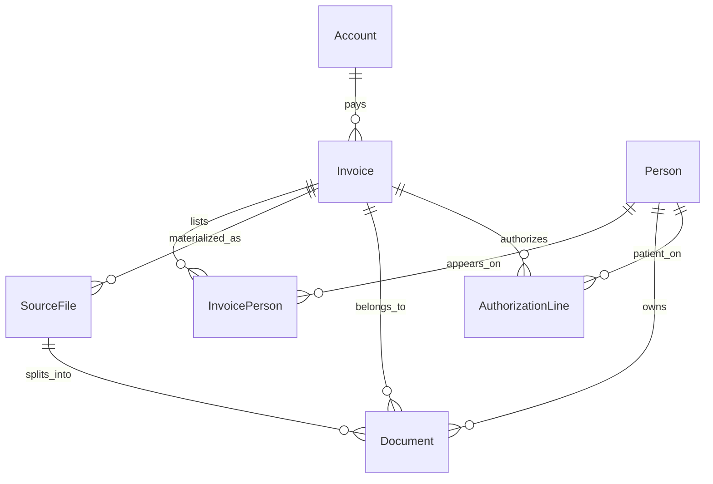

# Ávila GPS ETL architecture

Handbook for the person-centered invoice inventory: Neon schema, Vercel Blob page uploads, and the Next.js reader. Counts below reflect the pilot load unless marked as inventory-era.

## 1. Purpose and scope

- **Client = person = the titular of each invoice** (one titular per FACT). A beneficiary may also appear later; the primary person on the case is the titular.
- **Account = billed insurer or company** (La Previsora, Altamira, Seguros Miranda, …).
- **First load = invoice universe:** files labeled `invoice_packet`, `supporting`, or `needs_page_check` in `output/invoices/invoices.csv`, plus every page already OCR’d for those packets.
- **Out of this load:** Miranda scanner lots whose folder title has no FACT number (~43k files). Case folders that already contain `FACT n` packets stay in scope.

## 2. Source data map

| Artifact | Role |
| --- | --- |
| `Avila-backup/` | Read-only source files (never moved by the loader) |
| `scripts/invoice_rules.py` | Path classifier |
| `scripts/invoice_pages.py` | Fiscal vs attachment page judge |
| `scripts/document_types.py` | Personal `document_type` codes |
| `scripts/ocr_invoice_pages.py` | OCR cache writer |
| `output/invoices/invoices.csv` | File inventory (~70k classified rows) |
| `output/invoices/invoice-pages.csv` | Page labels for packets / candidates |
| `output/invoices/ocr/*.json` | Local OCR text cache (PHI; not uploaded to Neon) |

Inventory-era packet counts: about **7,200** invoice packets, **9,484** candidate pages, **564** supporting files.

## 3. Entity glossary

| Entity | Owns | Notes |
| --- | --- | --- |
| `avila.account` | Payer | Canonical codes such as `la_previsora` |
| `avila.person` | Client | Identity + contact (`full_name`, CI, `birth_date`, `phone`, `address`); filled from workbooks then OCR/path |
| `avila.invoice` | Case number | One row per `invoice_number` (or synthetic `range:…`); may get `control_number` / `issue_date` from registers |
| `avila.invoice_person` | Role link | `titular` / `beneficiario` / `unknown` + optional `parentesco` and `source` |
| `avila.authorization_line` | Service / auth row | CLAVE, diagnosis, amounts, dates from sábana/relación/cintillo/claves |
| `avila.source_file` | Packet / supporting file | Unique `backup_path` |
| `avila.document` | One page | Unique Blob pathname; type + evidence tokens |

See [schema-relationships.md](../output/invoices/schema-relationships.md).

## 4. Personal document types

| Code | Spanish label | Detection |
| --- | --- | --- |
| `factura_fiscal` | Factura fiscal | Fiscal page judge |
| `cedula_identidad` | Cédula de identidad | Plastic card cues (`CEDULA DE IDENTIDAD` + card fields); not siniestro forms or actas |
| `carnet` | Carnet | Employer badge (e.g. BDV); crops stored separately from collage pages |
| `documentos_identificacion` | Documentos de identificación | GPS cover sheet mounting cédula + carnet (not “otro anexo”) |
| `acta_nacimiento` | Acta de nacimiento | Registro civil / birth certificate (not a cédula) |
| `pasaporte` | Pasaporte | Passport card cues (rare) |
| `egreso` | Egreso | Path / OCR |
| `ingreso` | Ingreso | Path / OCR |
| `informe_medico` | Informe médico | `informe` evidence |
| `comprobante` | Comprobante | Authorization / preliquidación |
| `carta_aval` | Carta aval | Path / folder |
| `presupuesto` | Presupuesto | Path role |
| `laboratorio` | Laboratorio | Clinical OCR |
| `imagenologia` | Imagenología | Rayos / eco |
| `orden_servicio` | Orden de servicio | Service-order cues |
| `otro_anexo` | Otro anexo | Fallback attachment |
| `ilegible` | Ilegible | Empty OCR / render failure |

The fiscal form field “C.I., R.I.F. o pasaporte” is **not** a personal document by itself. Only a photographed ID card becomes `cedula_identidad`.

## 5. Relationship diagram



Example: packet `FACT 12843.pdf` → several `document` rows (factura, informe, cédula, …) → each with its own Blob URL → person linked when a cédula page yields an identity number. Workbook rows enrich the same person with phone/DOB and attach `authorization_line` rows (CLAVE, diagnosis, amounts).

## 6. Split rule and Blob pathname

One page = one document = one Blob object.

```text
avila/invoices/{invoice_number_or_range}/{source_file_sha}/{page_index:03d}-{document_type}.png
```

- Loader: `scripts/upload_documents_to_blob.py` + `scripts/blob_put.mjs`
- Resume: rows with `upload_status = uploaded` are skipped
- **Store note:** prefer a **private** store (`BLOB_ACCESS=private` in `blob_put.mjs`). The reader always serves previews through authenticated `/api/blob/[documentId]`, which uses `@vercel/blob` `get(pathname, { access: 'private' })` and falls back to fetching `blob_url` for legacy public objects.

## 7. Neon schema

- SQL, applied in order: `001_schema`, `002_seed_accounts`, `003_person_enrichment`, `004_carnet_document_type`, `005_identity_document_types`, `006_provenance_review`, `007_person_name_folded`, `008_invoice_fiscal_fields`
- Schema name: `avila` (avoids colliding with auth `public.account` and other apps on the same Neon project)
- Apply with `DATABASE_URL_UNPOOLED`. `ALTER TABLE` waits for any open ETL transaction on the same table, so apply migrations between runs.
- Check: `python3 scripts/load_neon_schema_check.py`

### Provenance and review

| Table | Holds |
| --- | --- |
| `etl_run` | One row per script run: script, args, git sha, `dry`/`apply`, start/finish, counters |
| `field_provenance` | One row per changed field: entity + id, field, old/new **value hashes** (never values), source kind + ref, rule id, confidence, run |
| `review_item` | Decisions the ETL will not make alone (`duplicate_candidate`, `ci_conflict`, `workbook_titular`, `multiple_ci`, `dob_conflict`, `auth_match`, `segment_review`, `acta_titular`), deduped by `dedupe_key`, `open` → `accepted`/`rejected` |

`invoice_person.source` is a closed vocabulary (`workbook`, `path`, `ocr`, `ocr_cedula`, `fiscal_ocr`, `scan_packet`, `auth_match`, `resolver`, `review`, `case_evidence`, `manual`, `legacy_unknown`). `legacy_unknown` is the weakest source and any later evidence may replace it.

Every apply script calls `provenance.start_run` / `finish_run` and writes a counts-only report to `output/runs/{run_id}.md` (git-ignored). Writes made inside `provenance.source(kind, ref)` inherit that source in `field_provenance`.

## 8. Blob conventions

| In Neon | Not in Neon |
| --- | --- |
| `document_type`, evidence tokens | Full OCR page text |
| `blob_pathname`, `blob_url`, sha256 | Patient narrative from informes |
| Identity number when extracted | Backup paths in public HTML titles |

OCR JSON under `output/invoices/ocr/` stays on disk as cache.

## 9. Load workflow

1. Classify paths / pages (already done for the inventory).
2. `psql` apply schema + seed accounts.
3. Pilot: `python3 scripts/upload_documents_to_blob.py --paths-file output/invoices/pilot-paths.txt`
4. Full: `python3 scripts/upload_documents_to_blob.py` (resumable).
5. Reader reads Neon; previews go through `/api/blob/...`.

### Pilot result (counts only)

| Measure | Value |
| --- | ---: |
| Source files | 20 |
| Documents | 160 |
| Uploaded | 160 |
| Persons resolved from cédula OCR | 1 |
| Factura fiscal pages | 25 |
| Cédula pages | 11 |

## 10. Reader UI

App root: `web/`

| Path | Purpose |
| --- | --- |
| `/` | Dashboard counts (deep-links into filtered lists, incl. `upload_status=failed`) plus link-quality KPIs: authorization lines with invoice, invoices with a CI titular, people with no invoice, open review items, scanner files loaded |
| `/personas` | Person directory: `q`, `has_ci`, `has_phone`, `role`, `account` + pagination |
| `/personas/[id]` | Relation hub: contacto, facturas, archivos fuente (via invoices), autorizaciones, docs identidad + expediente, **Historial** (`field_provenance`: source, rule, date, confidence) |
| `/revision` | Review queue: pills by kind and status; Aceptar / Rechazar are Server Actions that close the item and write `review` provenance (accept merges duplicates, promotes the CI titular, or links the authorization line) |
| `/facturas` | Invoice directory: `q`, `account`, `year`, `month`, `has_person` + pagination |
| `/facturas/[id]` | Resumen + personas + autorizaciones + archivos + páginas (`?file=` filters pages) |
| `/documentos` | `q`, `type`, `upload_status`, `account` + pagination |
| `/documentos/[id]` | Preview, source file, siblings, links to factura/persona |
| `/sign-in` | Email and password. Public signup is closed |
| `/usuarios` | Super admin: create accounts and assign `super_admin`, `revisor`, or `lector` |
| `/api/blob/[documentId]` | Document bytes after a valid session |

**Person → archivos fuente** is composed in the reader (`invoice_person` → `source_file`), not a DB FK. Identity pages use `document.person_id`; packet pages use the expediente join through invoices.

Stack: Next.js App Router, session cookie and roles, shadcn/ui, Montserrat, Ávila tokens (`#0A2A6B`, `#F4F8FC`, green gradient actions, `rounded-3xl` cards). Shared UI: `PageHeader`, `EmptyState`, `DocumentCard`, `RelationSection`, `EntityRow`, `ListFilterBar`, `DocumentTypeGroup`, `SectionNav`, `UploadStatusBadge`, `Breadcrumbs`, `Pagination`.

Public marketing SPA (separate deploy): `marketing/` on Netlify with SPA rewrites. Visitor data → WhatsApp only; never Neon/Blob.

## 11. How to run

Environment variable **names** (values live in repo-root `.env`, never commit them):

- `DATABASE_URL`, `DATABASE_URL_UNPOOLED`
- `BLOB_READ_WRITE_TOKEN`, `BLOB_STORE_ID`, `BLOB_ACCESS` (`private` preferred; `public` for legacy store)
- Optional `AUTH_BOOTSTRAP_USERS` for `scripts/seed_app_users.mjs` (`email|password|role|name`, semicolon-separated)

```bash
# Schema
psql "$DATABASE_URL_UNPOOLED" -f sql/001_schema.sql -f sql/002_seed_accounts.sql

# Blob helper deps
cd scripts && npm install

# Pilot / full load (private Blob by default)
export PATH="/opt/homebrew/bin:$PATH"
export BLOB_ACCESS=private
python3 scripts/upload_documents_to_blob.py --paths-file output/invoices/pilot-paths.txt
python3 scripts/upload_documents_to_blob.py

# Reader
cd web && npm install && npm run dev

# Marketing
cd marketing && npm install && npm run dev
```

Vercel project `etl-avila` uses SSO Deployment Protection on all deployments, plus the reader session and role check on app routes.

## 12. Edge cases

- Duplicate packets share one invoice via `duplicate_group`.
- FACT range folders use synthetic invoice keys `range:{a-b}` until a printed number is extracted (reader shows “Rango …”).
- Mixed / blank account labels leave `account_id` null (reader shows “(sin cuenta)”).
- Presupuesto files are not `factura_fiscal`.
- Ilegible pages get `document_type = ilegible` and may have no image body (amber badge in reader).
- Failed Blob uploads surface as “Fallido — reintentar carga”; preview falls back to an error state without exposing backup paths.
- Claim forms (declaración de siniestro, solicitud de carta aval / reembolso, reclamo letters) print a “FACTURA N°” box; `judge_page` returns `attachment/claim_form` unless the page also has crédito fiscal / forma libre markers.
- A patient report with an APS footer is `informe_medico`, not `orden_servicio`, unless it is titled as an order.
- A cédula plus a BDV carnet on one untitled page is the ID collage (`documentos_identificacion`, evidence `collage_untitled`).
- The `CARTA AVAL` scanner folder name is the last fallback, after every OCR rule.
- Workbook `FECHA DE NACIMIENTO` belongs to the beneficiary only when it follows a beneficiary name/CI column; otherwise it is the titular's. The person row is fill-only for DOB; a different incoming DOB opens a `dob_conflict` review.
- Scanner packets often have an unreadable invoice-number box but a readable control number; the loader resolves those through `invoice.control_number`. A control number that maps to zero or several invoices is skipped, not guessed.
- Two people with different cédulas are never merged, by the resolver or the review queue.
- Some scanner files named `.PDF` are JPEGs. The loader and `blob_put.mjs` sniff the leading bytes, so they upload as `image/jpeg`. Empty 235-byte PDFs have no page and stay `failed / no_image`.
- Workbook authorization dates in 1899/1900 are blank cells; the matcher treats any date before 2000 as missing.
- Authorization workbooks are mostly 2023–2025 while the invoice corpus is 2025–2026, and their claves do not overlap. Most lines therefore have no candidate invoice, which is expected, not a matcher failure.

## 13. Privacy

- Do not put credentials, patient names, or cédulas in docs or commit messages.
- Do not log identity numbers.
- Reader: signed session and role check, plus Deployment Protection. Blob bytes only through `/api/blob` after auth.
- Prefer a **private** Blob store (`BLOB_ACCESS=private`). OCR JSON stays on disk, not in Neon.
- Marketing: visitor fields stay in React state and leave only via `wa.me/584121716058`.

## 14. Person enrichment loop

1. Apply `sql/003_person_enrichment.sql` (demographics + `authorization_line`).
2. Inventory: `PYTHONPATH=scripts .venv/bin/python -m workbook_enrichment inventory`
3. Load workbooks first: `PYTHONPATH=scripts .venv/bin/python -m workbook_enrichment run --apply [--family sabana|claves|relacion|amp]`
4. One-time / periodic dedupe: `PYTHONPATH=scripts .venv/bin/python cleanup_person_duplicates.py --apply` (junk folder names + merge same-name provisionals). Provisional keys are `name:{folded}` (not per-invoice).
5. Path/OCR gap fill via `upload_documents_to_blob.py` / `backfill_titulares.py`. Workbook titulars with CI/contact are not overwritten by weak path names. Use `--metadata-only` when refreshing links without re-rendering Blob pages. Role rule: a plastic ID / carnet CI on the packet is titular; a different FACT path name becomes `beneficiario` (not a second titular).
6. Shared helpers live in `scripts/person_upsert.py`. Reader `/personas/[id]` shows contact fields and authorization lines.
7. Contact fill, after roles: `repair_workbook_contact.py` then `enrich_person_contact.py`. Both are fill-only. A different birth date, phone, or address opens a review and does not overwrite. Every person gets `contact_gap` (`birth_date`, `phone`, `address`), and the profile prints that reason under an empty field. Workbook phone and address stay on the titular; only the emergency-contact column is written on a beneficiario. Page text comes from the OCR cache of loaded documents and of scanner packets at confidence ≥ 0.6. A minor's phone and address are not copied from the titular.

### Phase order for a full refresh

Each script is dry-run first, then `--apply`. All of them record `etl_run`, provenance and review items.

| Phase | Script | Output |
| --- | --- | --- |
| 1 Types | `reclassify_identity_pages.py --all --quiet` | Corrected `document_type`; acta demotions open `acta_titular` |
| 1 DOB | `repair_workbook_birth_dates.py` | Clears or sets DOBs that were copied from the wrong workbook column |
| 2 People | `identity_resolver.py` | Auto-merges only score ≥ 0.95 with equal DOB and no titular/beneficiario overlap; 0.75–0.95 → `duplicate_candidate` |
| 3 Fiscal | `fiscal_extract.py --link-roles` | Fill-only control number, issue date, totals, clave; fiscal titular CI via `try_promote_ci_titular`; patient → beneficiario |
| 3 Auth | `match_auth_lines.py` | Links `authorization_line.invoice_id` at score ≥ 0.70 with a 0.15 margin; 0.45+ → `auth_match` |
| 4 Scanner OCR | `ocr_invoice_pages.py --scope scan [--folder …]` | Resumable OCR cache + `scan-pages.csv` |
| 4 Segment | `segment_scan_packets.py --reviews` | `scan-packets.csv`; low-confidence packets → `segment_review` |
| 4 Load | `upload_documents_to_blob.py --scan-packets [CSV] --shard i/n` | Packets ≥ `--min-confidence` load as `scan_packet`; then rerun phase 3 Auth |
| 5 Roles | `role_verify.py` then `--write-cohort --apply` | One evidence cohort per invoice; KPI `mismatch_no_beneficiario`; snapshot + `invoice.role_cohort` |
| 5 Roles | `role_verify.py --repair` / `fiscal_extract.py --missing-titular --link-roles --roles-only` | Auto-safe fill for no_titular / nameless / mismatch cohorts |
| 5 Roles | `role_linkage.py beneficiario\|propagate\|workbook\|all [--role-cohort …]` | Path/fiscal beneficiario harvest; pair propagation; sabana relink |
| 5 Roles | `repair_corpus_person_roles.py [--role-cohort id_docs_no_ci]` | CI from identity pages → titular; `multiple_ci` → review queue |
| 5 Roles | `role_verify.py` again | Confirm cohort deltas before contact enrichment |
| 5 Review | Reader `/revision` | Staff decisions, recorded as `review` provenance; auth accept also links beneficiario |
| 6 Contact | `repair_workbook_contact.py` then `enrich_person_contact.py` | Fill-only phone, address, and birth date; `contact_gap` reason when a field stays empty |

Scanner-lot discovery: scanner files are inventory rows with `rule_id = scan_outside_invoice`. The scanner writes one image per page, in capture order: fiscal sheet, then the claim form, then informe and other attachments. A fiscal page opens a packet, and the pages after it belong to that packet until the next different fiscal sheet.

Scanner load: the loader is bound by Neon round trips, not CPU, so run 32–64 shards in parallel from one shell that ends with `wait` (shards started with a bare `&` die when the launching shell exits). Each packet commits on its own, so a shard can be stopped and rerun. A rare `UniqueViolation` from two shards touching the same invoice clears on retry: put that packet in its own CSV and rerun it.

Baseline / cleanup notes: `output/invoices/person-enrichment-baseline.md`, `output/invoices/person-cleanup-report.md`.

Worked example (titular CI vs path patient, document naming, reader links): [case-titular-beneficiario.md](./case-titular-beneficiario.md). Agent playbook: [`.cursor/skills/avila-etl-persons/`](../.cursor/skills/avila-etl-persons/SKILL.md).

## 15. Clinical phase: médico, especialidad, atención

Schema: `sql/011_medico_especialidad.sql`. It adds the especialidad taxonomy (`especialidad_area`, `especialidad`, `procedimiento`, `especialidad_term`, `especialidad_observation`), the doctor tables (`medico`, `medico_especialidad`, `medico_mention`), the per-report `atencion`, and the views `v_person_medico` and `v_especialidad_tree`.

### Especialidad normalization

One normalizer (`scripts/especialidad_normalize.py`) serves OCR pages, fiscal lines, and sábana service text. It works in five levels:

| Level | What happens |
| --- | --- |
| L0 Raw | The term plus its context: `label`, `doctor_title`, `report_title`, `referral`, `fiscal_line`, `workbook_servicio`, `auth_line`, `directory` |
| L1 Clean | Fold accents and case, strip the university, fold gender (`-ICA` to `-ICO`), repair misread `MEDICO` |
| L2 Match | Exact, then phrase, then glued prefix, then suffix fragment, then guarded fuzzy (7+ letters, one unique best concept), else `none` |
| L3 Kind | `discipline`, `practitioner`, `adjective`, `procedure`, `role`, `degree`, `stop`. Adjectives count only in report titles, fiscal lines, auth lines, and sábana service |
| L4 Hierarchy | Area, especialidad (level 1), subespecialidad (level 2). A subespecialidad wins over its parent |

`MEDICO CIRUJANO` is the degree, never Cirugía. The catalog lives in `scripts/data/*.csv`; `especialidad_catalog.py load --apply` loads it, and `especialidad_catalog.py mine` lists unknown terms and opens `especialidad_unknown` reviews. `especialidad_backfill.py` normalizes `authorization_line.service_description`.

### Pipeline

| Step | Script | Output |
| --- | --- | --- |
| Extract | `clinical_extract.py [--limit N] [--invoices …]` | `output/runs/clinical-truth.jsonl`: one record per report (consecutive pages merged) with doctors, terms, patient block, date, diagnosis, fingerprint, invoice persons, fiscal and auth especialidades. No Neon writes |
| Resolve | `medico_resolve.py` | `output/runs/clinical-decisions.jsonl`: médico clusters, atenciones, reviews. No Neon |
| Apply | `clinical_apply.py [--apply]` | Upserts médicos, especialidades, mentions, atenciones, observations, reviews. Dry-run runs every write and rolls back |
| Verify | `clinical_verify.py [--apply] [--sample N] [--score CSV]` | Coverage cohorts, `clinical_verify_snapshot`, precision worksheet |

Rules the resolver applies:

1. Doctor. Mentions with the same MPPS are one médico. A name without MPPS joins the only MPPS cluster whose name matches (every token of the shorter name, one OCR edit allowed); otherwise it opens a provisional `name:` cluster. Two names under one MPPS open `medico_mpps_conflict`; two MPPS with the same name open `medico_duplicate`. Neither merges automatically. A `DR.` line in the body without a license is `referido` and never creates a médico. The GPS RIF `J-41029281-4` is the provider, never the doctor.
2. Treating doctor. `tratante` label first, then a stamp with MPPS, footer before header. An orden falls back to the `solicitante`.
3. Visit especialidad. Label, sello, report title, fiscal line, a single auth-line especialidad, the doctor's primary, the procedure's owner, then the report kind (laboratorio, imagen). `atencion.especialidad_source` records which one.
4. Patient. `ci_exact`, `name_on_invoice`, `sole_beneficiario`, `self_visit`, else `atencion_patient` review. The review suggests one person when exactly one candidate exists on the invoice or elsewhere. A person is never created from a report.
5. Duplicates. The same letter fingerprint is one report; later copies are `duplicate` with `duplicate_of`.

A patient, especialidad, or médico set by a reviewer is not overwritten by a later apply. Merged médicos keep their row with `merged_into`, and atenciones follow the merge target.

### Reader

`/medicos` (directory with area, especialidad, and MPPS filters), `/medicos/[id]` (ficha, especialidades, pacientes, atenciones), `/especialidades` (tree plus an unknown-term backlog for revisors), a Médicos tab on `/personas/[id]`, Atenciones on `/facturas/[id]`, a Clínico panel on `/informe`, and the Médico group on `/revision`. JSON: `/api/v1/medicos`, `/api/v1/medicos/[id]`, `/api/v1/especialidades`. Queries live in `web/src/lib/medico-data.ts`.

Accept effects: `medico_duplicate` merges the second médico into the first; `atencion_patient` links the report to the suggested person; `medico_mpps_conflict` and `especialidad_unknown` close the case only.

### Baseline (dry-run, 2026-11-21)

16,634 clinical pages make 15,588 reports (104 duplicates). Of the 15,484 unique reports, 58% have a médico, 61% an especialidad, and 72% a patient. The resolver finds 866 médicos (419 with MPPS). Unknown especialidad terms are 0.33% of 12,689 observations (target under 3%). Open reviews would be 3,960 `atencion_patient` (2,422 of them name a person linked to another invoice), 242 `medico_duplicate`, and 18 `medico_mpps_conflict`.

Run `clinical_apply.py --apply` only after the precision worksheet (`clinical_verify.py --sample 200`, then `--score`) meets the targets: doctor 95%, especialidad 90%, patient 95%.

## 16. Authorization lifecycle

An authorization line is one row of an insurer workbook (sábana, relación, or cintillo) under `Avila-backup/`. Schema: `sql/014_authorization_item.sql` (items and sources) and `sql/015_authorization_lifecycle.sql` (insurer, date origin, provider, and match outcome).

### Order of the steps

Each script is a dry-run until `--apply`, writes an `etl_run`, and records `field_provenance` for every field it changes.

| Step | Script | What it writes |
| --- | --- | --- |
| Load | `load_authorization_lines.py` | `authorization_line`, keeping existing values with `coalesce` |
| Items and titular | `repair_authorization_items.py` | `authorization_item` (consulta, estudio, servicio), `authorization_source` (file and `sheet:row`), `titular_person_id`, and `aps_code` |
| Especialidad | `especialidad_backfill.py` | `especialidad_id`, `procedimiento_id` |
| Dates | `repair_authorization_dates.py` | Clears Excel placeholder dates (year before 2000). Keeps real `request_date` or `service_date`; otherwise sets `period_month` from the month and year in the sheet or file name, or from the workbook save date (at most 6 months back). Sets `date_source` |
| Insurer and provider | `repair_authorization_fields.py` | `account_id` from the folder, `provider_code` (all G.P.S and GPS Ávila spellings fold to `gps_avila`) |
| Match | `match_auth_lines.py` | `invoice_id` when linked, plus `match_status`, `match_score`, `match_signals`, `matched_at` on every line |
| Audit | `authorization_audit.py [--label NAME]` | `output/runs/authorization-audit-NAME.md`, counts only |

### Match signals

Candidates are the facturas of the line's person, of its titular, and those that share its CLAVE, in the same insurer. Scores: CLAVE +0.60, person on the factura +0.40, otherwise titular on the factura +0.30, exact date with the factura 0 to 30 days later +0.20 (−0.20 when issued before, −0.20 when much later), period month equal to the factura month or the month before +0.10 (−0.20 when issued before the month or more than 6 months after), amount within 2% +0.15, similar service text +0.10, and the only candidate +0.10. The score links at 0.70 or more with a 0.15 margin over the runner-up, and opens an `auth_match` review from 0.45. The person joins the factura as beneficiario only when the CLAVE matched.

### `match_status`

| Value | Meaning |
| --- | --- |
| `linked` | The matcher linked it |
| `review` | An `auth_match` review is open, or a reviewer accepted one |
| `low_score` | The person or titular has facturas in the insurer, but none scored 0.45 |
| `no_candidate` | Neither the person nor the titular has a factura in that insurer, and no CLAVE matches |
| `no_person` | The line names no person, titular, or CLAVE |
| `duplicate` | The line copies another request (`duplicate_of`) |
| `staff` | Someone linked or unlinked it in `/autorizaciones`. The matcher never rescores it |

### Provenance rules

`authorization_date_repair` (reasons `period:named`, `period:saved`, `cleared:<field>`), `authorization_fields`, `match_auth_lines` (reason lists the signals), `review_auth_match` (Revisión accept), `staff_link_authorization` and `staff_unlink_authorization` (`source_kind='manual'`, `source_ref=/autorizaciones/<id>`), and `staff_link_authorization_beneficiario` when the link adds the patient to the factura.

### Reader

`/autorizaciones` has two views. Lista filters by state, insurer, contratante, especialidad, date quality, and year. Análisis shows the funnel, the reasons a line has no factura, the trend, each insurer, contratante, and especialidad, the days until the factura, and where each date came from. `/autorizaciones/[id]` shows the summary, items, patient and titular, the factura with candidate facturas, the origin row and copies, reviews, and the provenance history. Vincular and Desvincular need the `review` permission. JSON: `/api/v1/autorizaciones` (`?vista=analisis&rango=12m` for the analysis) and `/api/v1/autorizaciones/[id]`. Queries live in `web/src/lib/authorization-data.ts`.

### Result (2026-11-21, counts only)

Of 5,564 lines, the baseline had 1,146 linked, 3,913 with no date, and 512 with a placeholder date. After the repairs, 1,153 are linked, 3,732 have a period month, and 693 have no date at all. Every line has a `match_status`. Unlinked: 1,999 `low_score`, 1,827 `no_candidate`, 511 `no_person`, and 72 in review. For most `low_score` lines the nearest factura in the same insurer is 17 to 32 months after the authorization: the facturas from that period (mostly 2023) are not loaded, so loading them is what would raise the link rate.

## 17. Estudios by type

Schema: `sql/016_estudio.sql`. Families live in `estudio_tipo`. Each `procedimiento` that is a diagnostic study points at one family. `estudio.label` is the most specific name on the line or the page title: the test (Hemograma), the modality plus the body site (Rayos X de tórax), or the procedure when the page only names the family. The same specific name for one patient on one factura is one estudio. An order with no procedure name stays its own row. `estudio_archivo` attaches every source page: `documentacion` for the factura line, the order, or a written report, and `imagen` for a laboratorio or imagenología result sheet.

`estudio_extract.py --apply` rewrites `invoice_service`, then calls `avila.rebuild_estudios` and `estudio_catalogo.assign_catalog`. Schema `sql/017_estudio_catalogo.sql` adds the clinic catalog: level 1 is the service the clinic manages (Exámenes de laboratorio), level 2 is the named exam under it (Hematología completa). The reader catalog is `/estudios/catalogo`. Line provenance stays on `invoice_service`.

## 18. Roadmap

- Scanner packets whose fiscal sheet has neither a readable invoice number nor a control number (still orphaned).
- Improve cintillo workbooks that are image-only (OCR sheet embeds).
- Migrate remaining public Blob objects into the private store (re-upload with `BLOB_ACCESS=private`).
- Password reset by email for staff who lose the password a super admin set.
- Skip re-render when only person metadata refresh is needed.
