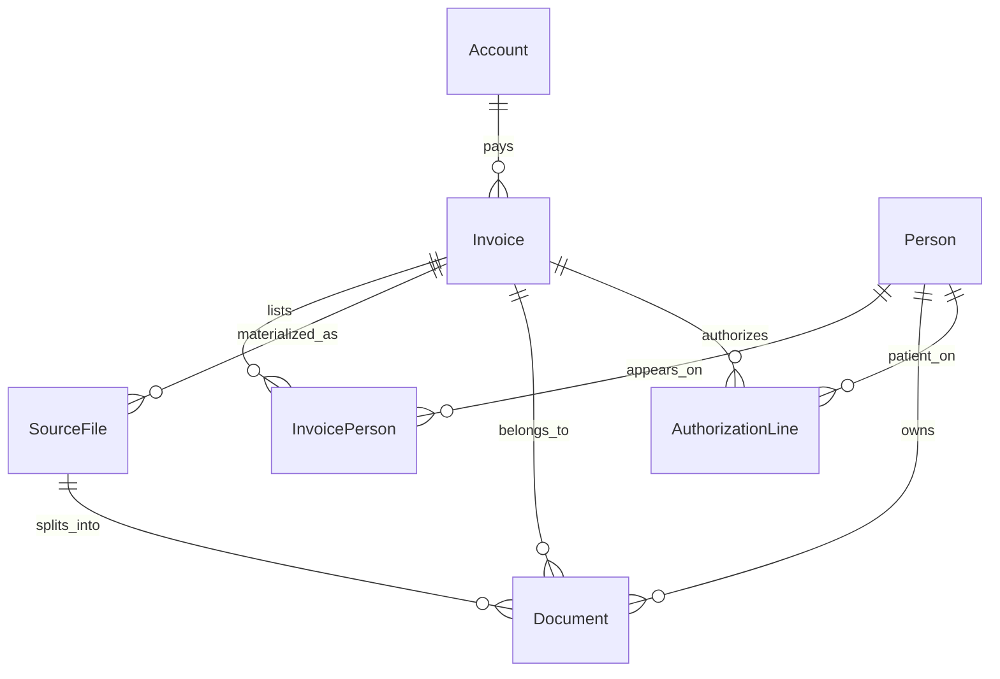

# Ávila GPS ETL architecture

Handbook for the person-centered invoice inventory: Neon schema, Vercel Blob page uploads, and the Next.js reader. Counts below reflect the pilot load unless marked as inventory-era.

## 1. Purpose and scope

- **Client = person = the titular of each invoice** (one titular per FACT). A beneficiary may also appear later; the primary person on the case is the titular.
- **Account = billed insurer or company** (La Previsora, Altamira, Seguros Miranda, …).
- **First load = invoice universe:** files labeled `invoice_packet`, `supporting`, or `needs_page_check` in `output/invoices/invoices.csv`, plus every page already OCR’d for those packets.
- **Out of this load:** Miranda scanner lots whose folder title has no FACT number (~43k files). Case folders that already contain `FACT n` packets stay in scope.

## 2. Source data map

| Artifact | Role |
| --- | --- |
| `Avila-backup/` | Read-only source files (never moved by the loader) |
| `scripts/invoice_rules.py` | Path classifier |
| `scripts/invoice_pages.py` | Fiscal vs attachment page judge |
| `scripts/document_types.py` | Personal `document_type` codes |
| `scripts/ocr_invoice_pages.py` | OCR cache writer |
| `output/invoices/invoices.csv` | File inventory (~70k classified rows) |
| `output/invoices/invoice-pages.csv` | Page labels for packets / candidates |
| `output/invoices/ocr/*.json` | Local OCR text cache (PHI; not uploaded to Neon) |

Inventory-era packet counts: about **7,200** invoice packets, **9,484** candidate pages, **564** supporting files.

## 3. Entity glossary

| Entity | Owns | Notes |
| --- | --- | --- |
| `avila.account` | Payer | Canonical codes such as `la_previsora` |
| `avila.person` | Client | Identity + contact (`full_name`, CI, `birth_date`, `phone`, `address`); filled from workbooks then OCR/path |
| `avila.invoice` | Case number | One row per `invoice_number` (or synthetic `range:…`); may get `control_number` / `issue_date` from registers |
| `avila.invoice_person` | Role link | `titular` / `beneficiario` / `unknown` + optional `parentesco` and `source` |
| `avila.authorization_line` | Service / auth row | CLAVE, diagnosis, amounts, dates from sábana/relación/cintillo/claves |
| `avila.source_file` | Packet / supporting file | Unique `backup_path` |
| `avila.document` | One page | Unique Blob pathname; type + evidence tokens |

See [schema-relationships.md](../output/invoices/schema-relationships.md).

## 4. Personal document types

| Code | Spanish label | Detection |
| --- | --- | --- |
| `factura_fiscal` | Factura fiscal | Fiscal page judge |
| `cedula_identidad` | Cédula de identidad | Plastic card cues (`CEDULA DE IDENTIDAD` + card fields); not siniestro forms or actas |
| `carnet` | Carnet | Employer badge (e.g. BDV); crops stored separately from collage pages |
| `documentos_identificacion` | Documentos de identificación | GPS cover sheet mounting cédula + carnet (not “otro anexo”) |
| `acta_nacimiento` | Acta de nacimiento | Registro civil / birth certificate (not a cédula) |
| `pasaporte` | Pasaporte | Passport card cues (rare) |
| `egreso` | Egreso | Path / OCR |
| `ingreso` | Ingreso | Path / OCR |
| `informe_medico` | Informe médico | `informe` evidence |
| `comprobante` | Comprobante | Authorization / preliquidación |
| `carta_aval` | Carta aval | Path / folder |
| `presupuesto` | Presupuesto | Path role |
| `laboratorio` | Laboratorio | Clinical OCR |
| `imagenologia` | Imagenología | Rayos / eco |
| `orden_servicio` | Orden de servicio | Service-order cues |
| `otro_anexo` | Otro anexo | Fallback attachment |
| `ilegible` | Ilegible | Empty OCR / render failure |

The fiscal form field “C.I., R.I.F. o pasaporte” is **not** a personal document by itself. Only a photographed ID card becomes `cedula_identidad`.

## 5. Relationship diagram



Example: packet `FACT 12843.pdf` → several `document` rows (factura, informe, cédula, …) → each with its own Blob URL → person linked when a cédula page yields an identity number. Workbook rows enrich the same person with phone/DOB and attach `authorization_line` rows (CLAVE, diagnosis, amounts).

## 6. Split rule and Blob pathname

One page = one document = one Blob object.

```text
avila/invoices/{invoice_number_or_range}/{source_file_sha}/{page_index:03d}-{document_type}.png
```

- Loader: `scripts/upload_documents_to_blob.py` + `scripts/blob_put.mjs`
- Resume: rows with `upload_status = uploaded` are skipped
- **Store note:** prefer a **private** store (`BLOB_ACCESS=private` in `blob_put.mjs`). The reader always serves previews through authenticated `/api/blob/[documentId]`, which uses `@vercel/blob` `get(pathname, { access: 'private' })` and falls back to fetching `blob_url` for legacy public objects.

## 7. Neon schema

- SQL: `sql/001_schema.sql`, `sql/002_seed_accounts.sql`
- Schema name: `avila` (avoids colliding with auth `public.account` and other apps on the same Neon project)
- Apply with `DATABASE_URL_UNPOOLED`
- Check: `python3 scripts/load_neon_schema_check.py`

## 8. Blob conventions

| In Neon | Not in Neon |
| --- | --- |
| `document_type`, evidence tokens | Full OCR page text |
| `blob_pathname`, `blob_url`, sha256 | Patient narrative from informes |
| Identity number when extracted | Backup paths in public HTML titles |

OCR JSON under `output/invoices/ocr/` stays on disk as cache.

## 9. Load workflow

1. Classify paths / pages (already done for the inventory).
2. `psql` apply schema + seed accounts.
3. Pilot: `python3 scripts/upload_documents_to_blob.py --paths-file output/invoices/pilot-paths.txt`
4. Full: `python3 scripts/upload_documents_to_blob.py` (resumable).
5. Reader reads Neon; previews go through `/api/blob/...`.

### Pilot result (counts only)

| Measure | Value |
| --- | ---: |
| Source files | 20 |
| Documents | 160 |
| Uploaded | 160 |
| Persons resolved from cédula OCR | 1 |
| Factura fiscal pages | 25 |
| Cédula pages | 11 |

## 10. Reader UI

App root: `web/`

| Path | Purpose |
| --- | --- |
| `/` | Dashboard counts (deep-links into filtered lists, incl. `upload_status=failed`) |
| `/personas` | Person directory: `q`, `has_ci`, `has_phone`, `role`, `account` + pagination |
| `/personas/[id]` | Relation hub: contacto, facturas, archivos fuente (via invoices), autorizaciones, docs identidad + expediente |
| `/facturas` | Invoice directory: `q`, `account`, `year`, `month`, `has_person` + pagination |
| `/facturas/[id]` | Resumen + personas + autorizaciones + archivos + páginas (`?file=` filters pages) |
| `/documentos` | `q`, `type`, `upload_status`, `account` + pagination |
| `/documentos/[id]` | Preview, source file, siblings, links to factura/persona |
| `/sign-in`, `/sign-up` | Clerk staff auth |
| `/api/blob/[documentId]` | Document bytes (Clerk + optional email allowlist) |

**Person → archivos fuente** is composed in the reader (`invoice_person` → `source_file`), not a DB FK. Identity pages use `document.person_id`; packet pages use the expediente join through invoices.

Stack: Next.js App Router, Clerk, shadcn/ui, Montserrat, Ávila tokens (`#0A2A6B`, `#F4F8FC`, green gradient actions, `rounded-3xl` cards). Shared UI: `PageHeader`, `EmptyState`, `DocumentCard`, `RelationSection`, `EntityRow`, `ListFilterBar`, `DocumentTypeGroup`, `SectionNav`, `UploadStatusBadge`, `Breadcrumbs`, `Pagination`.

Public marketing SPA (separate deploy): `marketing/` on Netlify with SPA rewrites. Visitor data → WhatsApp only; never Neon/Blob.

## 11. How to run

Environment variable **names** (values live in repo-root `.env`, never commit them):

- `DATABASE_URL`, `DATABASE_URL_UNPOOLED`
- `BLOB_READ_WRITE_TOKEN`, `BLOB_STORE_ID`, `BLOB_ACCESS` (`private` preferred; `public` for legacy store)
- `NEXT_PUBLIC_CLERK_PUBLISHABLE_KEY`, `CLERK_SECRET_KEY`
- Optional `CLERK_ALLOWED_EMAILS` (comma-separated staff emails)

```bash
# Schema
psql "$DATABASE_URL_UNPOOLED" -f sql/001_schema.sql -f sql/002_seed_accounts.sql

# Blob helper deps
cd scripts && npm install

# Pilot / full load (private Blob by default)
export PATH="/opt/homebrew/bin:$PATH"
export BLOB_ACCESS=private
python3 scripts/upload_documents_to_blob.py --paths-file output/invoices/pilot-paths.txt
python3 scripts/upload_documents_to_blob.py

# Reader
cd web && npm install && npm run dev

# Marketing
cd marketing && npm install && npm run dev
```

Vercel project `etl-avila` uses SSO Deployment Protection on all deployments, plus Clerk on app routes.

## 12. Edge cases

- Duplicate packets share one invoice via `duplicate_group`.
- FACT range folders use synthetic invoice keys `range:{a-b}` until a printed number is extracted (reader shows “Rango …”).
- Mixed / blank account labels leave `account_id` null (reader shows “(sin cuenta)”).
- Presupuesto files are not `factura_fiscal`.
- Ilegible pages get `document_type = ilegible` and may have no image body (amber badge in reader).
- Failed Blob uploads surface as “Fallido — reintentar carga”; preview falls back to an error state without exposing backup paths.

## 13. Privacy

- Do not put credentials, patient names, or cédulas in docs or commit messages.
- Do not log identity numbers.
- Reader: Clerk + Deployment Protection; blob bytes only through `/api/blob` after auth.
- Prefer a **private** Blob store (`BLOB_ACCESS=private`). OCR JSON stays on disk, not in Neon.
- Marketing: visitor fields stay in React state and leave only via `wa.me/584121716058`.

## 14. Person enrichment loop

1. Apply `sql/003_person_enrichment.sql` (demographics + `authorization_line`).
2. Inventory: `PYTHONPATH=scripts .venv/bin/python -m workbook_enrichment inventory`
3. Load workbooks first: `PYTHONPATH=scripts .venv/bin/python -m workbook_enrichment run --apply [--family sabana|claves|relacion|amp]`
4. One-time / periodic dedupe: `PYTHONPATH=scripts .venv/bin/python cleanup_person_duplicates.py --apply` (junk folder names + merge same-name provisionals). Provisional keys are `name:{folded}` (not per-invoice).
5. Path/OCR gap fill via `upload_documents_to_blob.py` / `backfill_titulares.py`. Workbook titulars with CI/contact are not overwritten by weak path names. Use `--metadata-only` when refreshing links without re-rendering Blob pages. Role rule: a plastic ID / carnet CI on the packet is titular; a different FACT path name becomes `beneficiario` (not a second titular).
6. Shared helpers live in `scripts/person_upsert.py`. Reader `/personas/[id]` shows contact fields and authorization lines.

Baseline / cleanup notes: `output/invoices/person-enrichment-baseline.md`, `output/invoices/person-cleanup-report.md`.

Worked example (titular CI vs path patient, document naming, reader links): [case-helber-aaron-matheus.md](./case-helber-aaron-matheus.md). Agent playbook: [`.cursor/skills/avila-etl-persons/`](../.cursor/skills/avila-etl-persons/SKILL.md).

## 15. Roadmap

- Miranda scanner lots without FACT context.
- Improve cintillo workbooks that are image-only (OCR sheet embeds).
- Migrate remaining public Blob objects into the private store (re-upload with `BLOB_ACCESS=private`).
- Tighten Clerk org / invite-only signup in production.
- Skip re-render when only person metadata refresh is needed.
