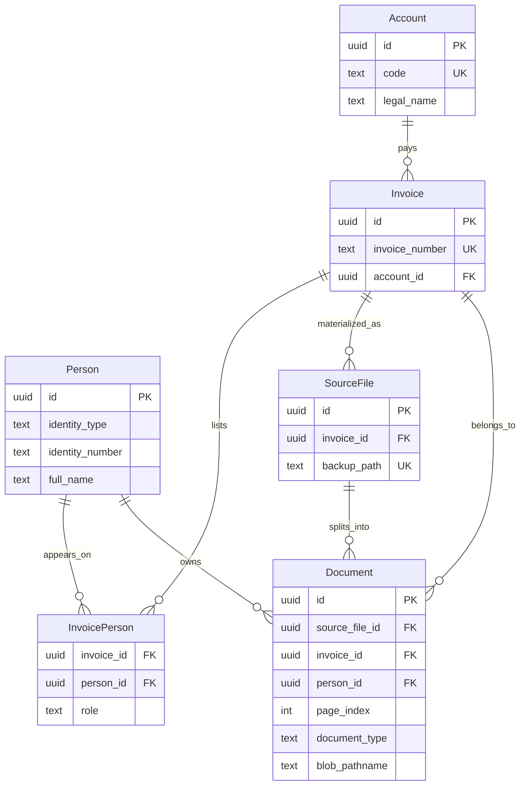

# Ávila schema relationships

Tables live in the Neon schema `avila` (isolated from other apps sharing the same database).

## Narrative of one case

1. A packet file such as `FACT 12843.pdf` becomes one `source_file` linked to invoice `12843`.
2. Each rendered page becomes one `document` with its own `document_type` and Blob pathname.
3. If a page is a cédula card, a `person` row is created or matched and linked through `invoice_person`.
4. The billed insurer (for example La Previsora) is the `account` on the invoice, not the client person.
